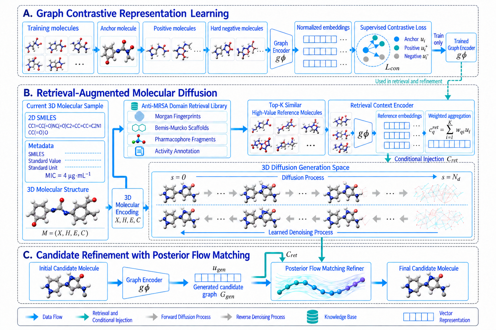

# Diff-AMRSA

**Retrieval-Augmented Three-Dimensional Molecular Generation for Anti-MRSA Research**

Research implementation of **Diff-AMRSA**. The project extends the [NVIDIA Megalodon](https://github.com/NVIDIA-Digital-Bio/megalodon) 3D generative backbone with three components: supervised graph contrastive representations, training-only anti-MRSA retrieval-conditioned diffusion, and coordinate-only flow-matching conformer refinement.

> **Reproducibility status**: Source code and independent component tests are provided. This repository does **not** include trained Diff-AMRSA-stage checkpoints or complete processed 3D dataset splits. The released files alone cannot regenerate the paper's quantitative results. Generated molecules and predicted activity are *not* experimentally validated antibiotic candidates.

## Overview of the Diff-AMRSA framework



**Overview of the Diff-AMRSA framework for anti-MRSA molecular candidate generation.**

- **(A) Graph contrastive representation learning.** A graph encoder is trained using anchor, positive, and hard-negative molecules with supervised contrastive loss to obtain normalized molecular embeddings for subsequent modules.
- **(B) Retrieval-augmented molecular diffusion.** Molecular encoding and reference-molecule retrieval are performed using the anti-MRSA domain library. The retrieved molecules are encoded and aggregated into a retrieval context, which is injected into the three-dimensional diffusion model to guide molecular generation.
- **(C) Candidate refinement with posterior flow matching.** The initial diffusion-generated candidate and its graph representation are processed together with the retrieval context to refine three-dimensional atomic coordinates while retaining molecular connectivity.

Detailed training objectives and module interfaces are described in the *Materials and Methods* section of the accompanying paper.

## Method and repository layout

```text
Diff-AMRSA/
├── src/diff_amrsa/                  # Graph encoder, retrieval, conditional diffusion and flow
├── src/megalodon/                   # Upstream pretrained backbone (preserved)
├── scripts/diff_amrsa/             # Full-method training, generation and evaluation
├── scripts/run_pipeline.sh         # Entrypoint for full-method stages
├── scripts/train_domain_adaptation.py  # Backbone domain-adaptation baseline
├── data_processing/               # MRSA table and 3D conformer preparation
├── evaluation/figures/            # Figure-generation utilities
├── evaluation/tables/             # Evaluation-table utilities
├── tests/diff_amrsa/              # Independent component tests
├── configs/                       # Example local paths
└── docs/                          # Experimental procedures, auditing and GitHub migration
```

The three new core components are:

- **Graph contrastive representation learning**: train the molecular graph encoder and export a canonical train-only retrieval index.
- **Retrieval-conditioned 3D diffusion**: top-K reference retrieval, context aggregation and denoiser conditioning on a separately initialized candidate.
- **Coordinate-only flow refinement**: graph-conditioned conformer correction without changing molecular atoms or bonds.

## Installation

Recommended: Linux, Python 3.10+, NVIDIA CUDA GPU. Package versions and PyG CUDA wheels must match your local GPU/PyTorch environment. A CUDA 12.6 / PyTorch 2.7 example is recorded in `requirements.txt`; **do not blindly install that CUDA-specific wheel set on CPU-only systems or incompatible CUDA releases**.

```bash
conda create -n diff-amrsa python=3.10 -y
conda activate diff-amrsa
# Choose a compatible PyTorch and PyG build for your machine first
pip install -e .
export PYTHONPATH="$PWD/src:$PYTHONPATH"
python -m pytest -q tests/diff_amrsa
```

`scikit-learn`, `joblib`, RDKit, PyTorch-Geometric and PyTorch are required by the relevant workflows. Checkpoint files must be sourced from a trusted location.

## Data and checkpoints

The example CSV files in the repository are *not* the processed model splits. You must supply the genuine `processed/train_h.pt`, `val_h.pt`, and `test_h.pt` plus their training priors, a Megalodon-compatible pretrained checkpoint and the stage-specific trained model weights. The complete table must **not** be used directly as the retrieval library; the index must be built from **train only**.

The primary dataset tools are:

```bash
python data_processing/prepare_dataset.py --help
python data_processing/build_conformers.py --help
bash scripts/run_pipeline.sh help
```

`data_processing/utils_data.py` recreates the previously missing PyG conversion and prior files. Categorical priors use all processed conformers. Reference 3D geometry histograms default to a deterministic subset of at most 5,000 conformers: do not treat these summary histograms as a validated replacement for reference-data metrics. Preprocessing should be validated against original processed data before comparing paper results.

## Run the full Diff-AMRSA workflow

From the root directory, use the new entrypoint to run one stage at a time, supplying the required arguments and checking artifacts after each stage:

```bash
bash scripts/run_pipeline.sh export-splits --help
bash scripts/run_pipeline.sh train-encoder --help
bash scripts/run_pipeline.sh train-diffusion --help
bash scripts/run_pipeline.sh export-conformers --help
bash scripts/run_pipeline.sh train-refiner --help
bash scripts/run_pipeline.sh generate --help
bash scripts/run_pipeline.sh train-proxy --help
bash scripts/run_pipeline.sh rank --help
```

See **[`docs/EXPERIMENT_GUIDE.md`](docs/EXPERIMENT_GUIDE.md)** for a complete, step-by-step example with the exact split and checkpoint arguments. Baseline-only experiments remain available separately (`scripts/run_legacy_pipeline.sh`, `docs/BASELINE_COMPARISON.md`); they are **not** equivalent to training the full retrieval-and-flow model.

## Testing and validation

```bash
PYTHONPATH=src python -m pytest -q tests/diff_amrsa
python -m compileall -q src scripts data_processing evaluation tests
bash -n scripts/run_pipeline.sh
```

Independent tests cover retrieval weighting, contrastive gradients, molecular graph preservation, numerical geometry, conditioner activation, and dataset split safety. No GPU training was performed for this publication cleanup; see [`docs/REPOSITORY_AUDIT.md`](docs/REPOSITORY_AUDIT.md) for verified fixes and unresolved integration risks.

Evaluation functions named `posebusters_inspired` are **not** the official PoseBusters and must not be used to report official PB-valid. Re-run official PoseBusters and the complete evaluation on generated candidates.

## Licensing and attribution

The underlying Megalodon implementation is credited to Reidenbach *et al.* (2025), with code and model-specific licenses and other third-party notices in [`LICENSE/`](LICENSE/) and [`MODEL_CARD_UPSTREAM.md`](MODEL_CARD_UPSTREAM.md). The added Diff-AMRSA code is a research extension. Respect separate license terms for pretrained NVIDIA model weights. See [`CITATION.cff`](CITATION.cff) for upstream citation information; update project authorship metadata before an official paper release.
